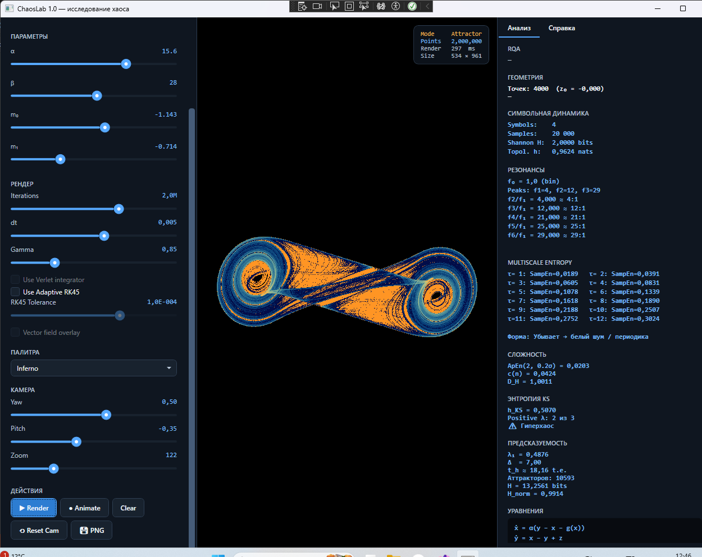

# ChaosLab

[](https://github.com/TheGhost1K/ChaosLab/actions/workflows/tests.yml)
[](https://github.com/TheGhost1K/ChaosLab/actions/workflows/build.yml)
[](https://codecov.io/gh/TheGhost1K/ChaosLab)
[](LICENSE)
[](https://dotnet.microsoft.com/)
[](https://www.microsoft.com/windows)
[](CHANGELOG.md)

**ChaosLab** — десктопное WPF-приложение для исследования
детерминированного хаоса. Строит фазовые портреты аттракторов,
бифуркационные диаграммы, карты Ляпунова, спектры и применяет
**24 метода нелинейного анализа**.



## Содержание

- [Возможности](#возможности)
- [Быстрый старт](#быстрый-старт)
- [Документация](#документация)
- [Примеры](#примеры)
- [Архитектура](#архитектура)
- [Разработка](#разработка)
- [Вклад](#вклад)
- [Лицензия](#лицензия)

## Возможности

### 33 вычислительные модели

- **20 непрерывных потоков** — Lorenz, Rössler, Aizawa, Thomas, Halvorsen,
  Chen, Dadras, Four-Wing, Sprott A, Chua's Circuit, Rikitake Dynamo,
  Newton-Leipnik, Rabinovich-Fabrikant, Shimizu-Morioka, Nosé-Hoover,
  Langford, Lorenz-96, Hénon-Heiles, FPUT-β, Coupled Pendulums
- **12 дискретных отображений** — Logistic, Hénon, Ikeda, Clifford,
  De Jong, Tinkerbell, Arnold Cat, Circle Map, Gumowski-Mira,
  Chirikov Standard, Tent, Gauss
- **1 реакционно-диффузионное поле** — Gray-Scott

### 10 режимов отображения

| Режим | Что показывает |
|---|---|
| **Attractor** | Фазовый портрет с накоплением плотности |
| **Bifurcation** | Диаграмма удвоения периода |
| **Lyapunov Map** | Тепловая карта λ₁(p₁, p₂) |
| **Cobweb** | Паутина итераций для 1D |
| **Power Spectrum** | Спектр через FFT |
| **Return Map** | Отображение xₙ → xₙ₊₁ |
| **FNN + MI** | Диагностика вложения |
| **Multifractal** | Спектр D_q |
| **Multiscale Entropy** | SampEn(τ) |
| **Trail** | Живой след траектории |

### 24 метода анализа

- **Спектральные** — Lyapunov spectrum (QR Бенеттина), KS entropy,
  Power spectrum, Resonance analysis
- **Фрактальные размерности** — D₂ (Грассбергер–Прокаччиа), D_box,
  D_KY (Kaplan-Yorke), Higuchi FD, Multifractal D_q
- **Энтропии** — Sample Entropy, Approximate Entropy, Permutation
  Entropy, Multiscale Entropy, Hurst exponent, DFA
- **Сложность** — Lempel-Ziv, Symbolic dynamics (топологическая энтропия)
- **Тесты на хаос** — 0–1 тест (Gottwald–Melbourne), RQA
- **Геометрия** — Сечения Пуанкаре, Бассейны притяжения, Return map
- **Предсказуемость** — Basin entropy, Predictability horizon

### Численные методы

- **RK4** — классический Рунге–Кутта 4-го порядка
- **Adaptive RK45** — Dormand-Prince с контролем локальной ошибки
- **Verlet** — симплектический интегратор для гамильтоновых систем
  (Hénon-Heiles, FPUT-β, Coupled Pendulums)

### Технические особенности

- **Аналитические якобианы** для всех систем (×2 ускорение Ляпунова)
- **Параллельные карты Ляпунова и бассейны** (×6–8 на типичном CPU)
- **Прогрессивный рендер** — превью 256×256 за 0.3 с
- **Асинхронный планировщик** с коалесцированием запросов
- **UI не блокируется** — все вычисления в фоновых задачах
- **Debounce слайдеров** — рендер перезапускается с задержкой
- **Vector field overlay** для 2D отображений
- **DPI-aware рендер** — работает на 125%, 150%, 4K
- **351+ unit-тестов**, покрытие **~88%**
- **Никаких `unsafe` / `stackalloc`** — весь код безопасный

## Быстрый старт

### Требования

- **Windows 10/11**
- **.NET 10 SDK** — [скачать](https://dotnet.microsoft.com/download/dotnet/10.0)

### Сборка и запуск

```bash
git clone https://github.com/TheGhost1K/ChaosLab.git
cd ChaosLab
dotnet build ChaosLab.slnx -c Release
dotnet run --project src/ChaosLab/ChaosLab.csproj
```

### Первый аттрактор за 30 секунд

1. Открывается аттрактор Лоренца по умолчанию.
2. Нажмите **Render** (или `Ctrl + R`).
3. Через 1–2 секунды увидите классический «двойной вихрь».

**Совет:** наведите мышь на слайдер **σ** — увидите тултип
«Число Прандтля: отношение вязкости к температуропроводности».

## Документация

| Раздел | Описание |
|--------|----------|
| [Начало работы](docs/articles/getting-started.md) | Установка, интерфейс, первый запуск |
| [Системы](docs/articles/systems/index.md) | 33 модели с уравнениями и параметрами |
| [Методы анализа](docs/articles/methods/index.md) | 24 метода с формулами |
| [Режимы отображения](docs/articles/rendering.md) | Attractor, Bifurcation, Trail и другие |
| [Архитектура](docs/articles/architecture.md) | Структура проекта и паттерны |
| [Разработка](docs/articles/development.md) | Как добавить систему или метод |
| [API Reference](https://theghost1k.github.io/ChaosLab/api/) | Автогенерируемая справка DocFX |

## Примеры

### Классический аттрактор Лоренца

```
1. Система:    Lorenz
2. Палитра:    Inferno
3. Iterations: 5M
4. Gamma:      0.85
5. Render
```

**Результат:** двойной вихрь с плотным ядром и фрактальной периферией.

### Граница перехода к хаосу

```
1. Система: Lorenz
2. Режим:   Lyapunov Map
3. Ось X:   ρ [1, 60]
4. Ось Y:   σ [1, 30]
```

**Результат:** тепловая карта с белой линией λ = 0 при ρ ≈ 24.7.
**Правый клик** по любой точке → переход в Attractor с этими параметрами.

### Сравнение интеграторов

```
1. Система: Hénon-Heiles
2. Включить: Use Verlet integrator
3. Iterations: 10M
4. Render → сравнить с RK4
```

**Результат:** Verlet сохраняет энергию на миллионах шагов, RK4 «уползает».

### Живая траектория (Trail)

```
1. Система: Chua's Circuit
2. Режим:   Trail
3. Кнопка:  Animate
```

**Результат:** траектория «прорисовывает» двойной свиток в реальном времени.

### Спектр Ляпунова

```
1. Система: Lorenz
2. Нажать:  λ Спектр
```

**Результат:**

```
λ[0] = +0.9062
λ[1] = +0.0001
λ[2] = -14.5718

✓ Хаос: 1 λ > 0 из 3
D_KY = 2.06
```

## Архитектура

```
ChaosLab/
├── src/ChaosLab/
│   ├── Core/                    # ChaoticSystem, Integrator, Camera3D, Palette
│   ├── Systems/                 # 33 вычислительные модели
│   ├── Analysis/                # 24 метода анализа
│   ├── Rendering/               # Рендереры (Attractor, Bifurcation, Plot)
│   ├── Services/                # RenderScheduler, AnalysisService
│   ├── ViewModels/              # MVVM (partial-классы для RenderViewModel)
│   └── Views/                   # XAML
├── tests/ChaosLab.Tests/        # 351+ unit-тестов, xUnit
├── docs/                        # DocFX документация
└── .github/workflows/           # CI
```

**Паттерны:**

- **MVVM** без фреймворков — вручную, `INotifyPropertyChanged` + `RelayCommand`
- **Асинхронный планировщик** с коалесцированием запросов
- **Аналитические якобианы** для всех систем
- **Параллельные вычисления** через `Parallel.For<TLocal>`
- **Никакого `unsafe`** — весь код безопасный

См. подробности в [docs/articles/architecture.md](docs/articles/architecture.md).

## Разработка

### Сборка

```bash
dotnet build ChaosLab.sln -c Release
```

### Тесты

```bash
# Все тесты
dotnet test

# Только быстрые
dotnet test --filter "Fast=true"

# С покрытием
dotnet test --collect:"XPlat Code Coverage"
```

### Запуск документации

```bash
dotnet tool install -g docfx
cd docs
docfx docfx.json --serve
```

Откройте `http://localhost:8080`.

### Добавить систему или метод

См. подробное руководство в
[docs/articles/development.md](docs/articles/development.md).

## Вклад

Мы рады любой помощи:

- **Новые системы** — присылайте с проверкой λ₁ на эталонных параметрах
- **Новые методы анализа** — со ссылкой на первоисточник
- **Оптимизации** — с бенчмарками
- **Исправления багов** — через GitHub Issues
- **Документация** — переводы, примеры, скриншоты

Перед отправкой PR:

- [ ] `dotnet build` без warnings
- [ ] `dotnet test` — все тесты зелёные
- [ ] `.editorconfig` соблюдён
- [ ] Коммиты в стиле [Conventional Commits](https://www.conventionalcommits.org/)
- [ ] Обновлена документация при необходимости

См. [CONTRIBUTING.md](CONTRIBUTING.md) для деталей.

## Лицензия

MIT — см. [LICENSE](LICENSE).

## Благодарности

- **Edward Lorenz** — за «эффект бабочки» и систему 1963 года
- **Otto Rössler** — за ленточный аттрактор
- **Leon Chua** — за первую электронную схему с хаосом
- **David Ruelle и Floris Takens** — за теорию странных аттракторов
- **Иниго Килез** — за косинусные палитры
- **Giancarlo Benettin** — за QR-метод спектра Ляпунова
- **Peter Grassberger и Itamar Procaccia** — за корреляционную размерность
- **Joshua Richman и J. Randall Moorman** — за Sample Entropy
- **Christoph Bandt и Bernd Pompe** — за Permutation Entropy
- **Mitchell Feigenbaum** — за универсальность каскада удвоения

## Ссылки

- [GitHub Repository](https://github.com/TheGhost1K/ChaosLab)
- [Issue Tracker](https://github.com/TheGhost1K/ChaosLab/issues)
- [Discussions](https://github.com/TheGhost1K/ChaosLab/discussions)
- [Releases](https://github.com/TheGhost1K/ChaosLab/releases)
- [Changelog](CHANGELOG.md)

---

<div align="center">

**ChaosLab 1.0** — построен на .NET 10 и WPF

⭐ Поставьте звезду, если проект оказался полезным!

</div>
